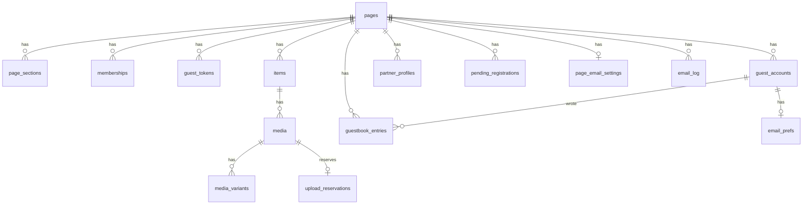

# Design 3: Data model

**Status:** v1.0, **approved by the owner 2026-10-23** (merged 2026-10-22: "finish the database model, commit and merge"). Codex adversarial review: 11 rounds, last verdict **approve**. History: v0.2 answered Q42-Q45, added the trusted write path §3.9 and upload reservations §3.4, corrected Zodiac to the couple's own data §3.10; v1.0 added Zodiac systems, birthplace/time, publication snapshot and guest disclosure levels. Open: Q50 (event line). Facts marked **unverified** or "to verify in research" are checked before the feature that needs them is built. No code. Table and column lists below are a contract for Phase 1 migrations, not SQL.
**Date:** 2026-10-22
**Inputs:** PRD §3.1, §4.3, §5, §9.2, §12 (Q15, Q17, Q27, Q29, Q30, Q34, Q35, Q38, Q39); design 1 (`anni_token_flow.md`) §3, §5, §10, §11; design 2 (`anni_screens.md`) "What this tells the data model"; plan §1, §3, §4.
**Supersedes:** the sketch in plan §4. Changes from it are listed in §2.
**Privacy:** placeholders only. No real names, dates, emails, tag IDs or tokens appear in the schema, seed data or tests.
**Single-source rule:** decisions stay in PRD §12. New questions raised here are Q42–Q45.

---

## 1. Principles

1. **Tenant column everywhere.** Every row carries `page_id`. The only exceptions are rows that belong to a user who is bound to exactly one page (§3.6), operational tables that hold no page content (§3.8), and the shared Zodiac reference tables (§3.11). Cross-table references that stay inside a page use **composite foreign keys** `(id, page_id)`, so the database itself refuses a row that points into another page.
2. **Deny by default (PRD §4.3, design 1 §9).** Row-level security (RLS) is on for every table. The `anon` role has **no** table privileges. Guests reach data only through the `public_*`, `guest_*` and `account_*` functions (design 1 §5.1). Members (the owner account) reach rows through RLS policies keyed on `memberships`.
3. **Publication boundary.** Content has `draft | published`; guestbook entries have `pending | approved | rejected`; media has an upload `state`. Guest functions return only published, approved and ready rows in enabled sections (E28).
4. **Unguessable identifiers.** Primary keys are random UUIDs (`gen_random_uuid()`), never sequences, because some of them appear in guest URLs.
5. **Minimum personal data.** No raw IP address and no raw guest token is stored anywhere. Guests' birthdays are never collected. The partners' own birth dates are stored only encrypted (§3.10, Q46). Emails are stored only where sending needs them (§3.7).
6. **Overwrite check.** Every editable row has an integer `version` that a trigger increments. An update must name the version it read; zero rows updated means "changed by someone else" (E15, screen O5).
7. **Text hygiene.** Every user-visible text column is stored in Unicode NFC (a check constraint compares the value with its normalised form, E12) and has a length cap.

## 2. Changes from the plan §4 sketch

| Change | Reason |
|---|---|
| One `items` table with a `kind` column replaces separate `memories`, `milestones`, `anniversaries` (and later `places`) tables | Media then needs one foreign key, not a polymorphic link. Guests get one publication predicate and one overwrite rule. Per-kind rules are check constraints (§3.3). Alternative in §8 |
| `pages.enabled_sections` becomes a `page_sections` table | New sections (Zodiac, later places) are new rows, not schema changes |
| `invites` table removed | Closed registration (Q30) and one shared account (Q35) leave nothing to invite. The `co_editor` role stays in `memberships` |
| `token_shown_at` moves from `pages` to `guest_tokens.shown_at` | It describes one token version, not the page |
| `profiles_zodiac` (guest signs) replaced by `partner_profiles` (§3.10) | Owner correction 2026-10-22: Zodiac is about the couple's own birth data, not the guests' |
| New operational tables: `rate_limit_hits`, `job_runs`, `storage_deletions` | Rate limits shared across serverless instances, the keep-alive heartbeat, and media deletion that survives failures |

## 3. Tables

Types are PostgreSQL. `tstz` = `timestamptz` (stored in UTC). Every table also has `created_at tstz not null default now()` unless noted.

### 3.1 Pages and sections

**`pages`**
| Column | Type | Rule |
|---|---|---|
| `id` | uuid PK | random |
| `theme` | enum `theme_id` (`a_dreamy`, `b_cosmic`, `c_cozy`, `d_elegant`) | PRD §6.2; new themes add enum values |
| `default_lang` | enum `lang` (`en`, `vi`) | |
| `visibility` | enum `visibility` (`private`, `token_only`, `published`) | default `token_only` (S3) |
| `timezone` | text | IANA name, required. O3 fills it from the owner's browser and lets them change it. Used by the counter and reminders (E14) |
| `vanity_name` | text null, unique | Only routed while `visibility = published`; kept but inert otherwise |
| `setup_completed_at` | tstz null | Null = O2 shows "Set up your page" |
| `version`, `updated_at` | int, tstz | §1.6 |

**`page_sections`** (PK `page_id, section`)
| Column | Type | Rule |
|---|---|---|
| `page_id` | uuid FK `pages` on delete cascade | |
| `section` | enum `section_id` (`home`, `memories`, `together`, `guestbook`, `zodiac`) | `places` is added after core |
| `enabled` | bool | default **false** (PRD §4.1: sections off until enabled) |
| `sort_order` | smallint | navigation order |

All five rows are created with the page, so "enabled" is never inferred from a missing row.

### 3.2 Members and guest tokens

**`memberships`** (PK `page_id, user_id`)
| Column | Type | Rule |
|---|---|---|
| `page_id` | uuid FK `pages` on delete cascade | |
| `user_id` | uuid FK `auth.users` on delete cascade | |
| `role` | enum `member_role` (`owner`, `co_editor`) | partial unique index: one `owner` and at most one `co_editor` per page (Q15) |

A trigger refuses a user who already has a `guest_accounts` row, and the `guest_accounts` trigger refuses a member: one auth user is either a member or a guest, never both (E33).

**`member_settings`** (PK `user_id`): `ui_lang lang`, `tour_seen_version smallint default 0` (O13, Q40). One row for the shared account (Q35).

**`guest_tokens`**
| Column | Type | Rule |
|---|---|---|
| `id` | uuid PK | |
| `page_id` | uuid FK `pages` on delete cascade | |
| `version` | int | unique `(page_id, version)`; rotation writes `max + 1` |
| `token_hash` | bytea, unique | SHA-256 of the raw token (design 1 §3). The raw token is never stored |
| `active` | bool | partial unique index `(page_id) where active`: one live token, so concurrent rotations resolve to one (design 1 §3.2) |
| `request_id` | uuid, unique | idempotency key from the O8 request: a retry returns "already rotated", not a second token |
| `shown_at` | tstz null | null = O8 shows "link not shown yet" with Rotate again |
| `deactivated_at` | tstz null | set in the same transaction as the new row |
| `created_by` | uuid FK `auth.users` | |

### 3.3 Content: `items`

| Column | Type | Rule |
|---|---|---|
| `id` | uuid PK; unique `(id, page_id)` | target of composite FKs |
| `page_id` | uuid FK `pages` on delete cascade | |
| `kind` | enum `item_kind` (`home`, `memory`, `milestone`, `anniversary`, `zodiac_sign`; later `place`) | |
| `section` | `section_id`, generated from `kind` | `home→home`, `memory→memories`, `milestone/anniversary→together`, `zodiac_sign→zodiac`. Guest predicates join `page_sections` on it |
| `status` | enum `pub_status` (`draft`, `published`) | default `draft` |
| `published_at` | tstz null | set when first published |
| `lang` | `lang` | language of the main text |
| `title` | text | 1–120 chars, NFC |
| `body` | text null | ≤ 5,000 chars, NFC, plain text |
| `lang_alt`, `title_alt`, `body_alt` | null | optional second language (S12). Check: all null, or `lang_alt` set and different from `lang`. Missing alt falls back to the main text (E13) |
| `event_date` | date null | |
| `date_precision` | enum (`day`, `month`, `year`) null | design 2: memories may know only a month or a year. Stored as the first day of the period |
| `recurs_yearly` | bool default false | anniversaries only |
| `remind_owner` | bool default false | anniversaries only; feeds the reminder mail (S18) |
| `start_date` | date null | home only: the "together since" date for the counter |
| `cover_media_id` | uuid null | home only; composite FK `(cover_media_id, page_id)` → `media` |
| `zodiac_system`, `zodiac_key` | enum (`western`, `vietnamese`), text null | `zodiac_sign` items only: which sign this art is for (a Western sign or a Vietnamese animal); unique `(page_id, zodiac_system, zodiac_key)` |
| `sort_order` | numeric | owner reorder (O4); fractional so a move updates one row |
| `version`, `updated_at`, `created_by`, `updated_by` | | §1.6 |

Per-kind check constraints:
| Kind | Required | Must be null |
|---|---|---|
| `home` | `start_date` | `event_date`, `recurs_yearly = false`, `zodiac_system`, `zodiac_key` |
| `memory` | `event_date`, `date_precision` | `start_date`, `zodiac_system`, `zodiac_key`, `cover_media_id` |
| `milestone` | `event_date`, `date_precision` | `start_date`, `zodiac_system`, `zodiac_key`, `cover_media_id` |
| `anniversary` | `event_date`, `date_precision = day` | `start_date`, `zodiac_system`, `zodiac_key`, `cover_media_id` |
| `zodiac_sign` | `zodiac_system`, `zodiac_key` | dates, `cover_media_id` |

Partial unique index: one `home` item per page.

**Counting and calendar rules** (E14), computed in the page's `timezone`, never the server's or the guest's:
- The start date is **day 1** (Q44). Counter = (today in `pages.timezone` − `start_date`) + 1.
- Before the start date has begun in that time zone, guests see no counter at all; the owner's dashboard shows "counter starts on [DATE]" (Q44).
- A yearly anniversary on 29 February falls on **28 February** in other years (Q42). The same rule applies to reminder mail.

**Zodiac art (Q39).** The owner's sign characters are content, not code: each is a `zodiac_sign` item with one image in `media`, stored in the private bucket and served through signed URLs like any memory photo. This keeps the art out of Git (rule 3) and lets the owner replace it from the dashboard. Budget proposal: ≤ 150 KB per image (display variant). Guests load only the images for the couple's signs in the system on screen (two images, two more if they switch systems), when the Zodiac section opens. Art can exist for both systems (12 Western signs, 12 Vietnamese animals). Until the owner uploads the art, built-in default art ships with the app from `assets/zodiac-sign/`: the final style is the two owner-approved source sheets (Western and Vietnamese, `source-sheets.json`, approved 2026-10-22), exported to one safe square SVG per sign (24, rules in the folder README); until those exist, the section shows sign names without art. These are the only image files the `privacy-scan` job allows outside placeholders (plan §12.2). The data the signs are computed from is in §3.10.

### 3.4 Media

**`media`**
| Column | Type | Rule |
|---|---|---|
| `id` | uuid PK; unique `(id, page_id)` | |
| `page_id` | uuid FK `pages` on delete cascade | |
| `item_id` | uuid null | composite FK `(item_id, page_id)` → `items` on delete cascade. Null only while `state = uploading` |
| `kind` | enum (`photo`, `video`, `audio`) | |
| `state` | enum (`uploading`, `ready`, `failed`) | guests see `ready` only. Lifecycle and cleanup: upload admission below (E9) |
| `position` | smallint | order inside the item |
| `width`, `height`, `duration_ms` | int null | from the processed file |
| `alt`, `alt_alt` | text null | ≤ 300 chars, NFC; accessibility text in each language |
| `created_by` | uuid FK `auth.users` | |

A guest never sees an original upload: EXIF and location are stripped and the file is re-encoded in the browser before upload (FR7, E7), and only processed variants are stored.

**`media_variants`** (PK `media_id, variant`)
| Column | Type | Rule |
|---|---|---|
| `media_id` | uuid FK `media` on delete cascade | |
| `page_id` | uuid | composite FK with `media_id` |
| `variant` | enum (`thumb`, `display`, `poster`, `full`, `audio`) | `poster` for video (click-to-play, plan §3) |
| `storage_key` | text unique | bucket (size class, §3.4) plus `pages/<page_id>/media/<media_id>/<variant>`; random IDs only, never a file name |
| `mime` | text | allow-list (E8) |
| `bytes` | bigint | ≤ 50 MB (Q27, plan §3) |

**Upload admission with reservations (Codex review 2026-10-22, finding 2).** Counting only finished files lets two uploads that start together both pass the check and together exceed the budget. So space is reserved when an upload starts.

`pages.storage_budget_bytes` (bigint): proposal 900 MB, leaving headroom under the 1 GB project limit (plan §3). One page exists today, so this is the whole project in practice.

**`upload_reservations`** (PK `media_id`)
| Column | Type | Rule |
|---|---|---|
| `media_id` | uuid FK `media` | |
| `page_id` | uuid | composite FK with `media_id` |
| `variants` | admitted list of `(variant, max_bytes)` | the only object paths this upload may write |
| `charged_bytes` | bigint | what the budget counts for this upload (rule below) |
| `write_until` | tstz | end of the write window: `created_at + 1 h`; the signed upload URLs must expire before it |

**Charging rule (Codex rounds 2 and 3).** Every byte that may still be in a bucket is charged in exactly one place:

`used(page) = sum(media_variants.bytes) + sum(upload_reservations.charged_bytes) + sum(storage_deletions.bytes where done_at is null)`

Bytes **move** between those places inside one transaction and are never dropped in between:
- Complete: reservation → `media_variants` (real sizes).
- Cancel, expiry or refused Complete: reservation → `storage_deletions` rows (one per admitted path, charged at the reservation's per-path amount), then the reservation is deleted.
- Deleting finished media, directly or through an item or page cascade: a `before delete` trigger on `media_variants` inserts the `storage_deletions` row with the variant's recorded bytes in the same transaction, so the charge survives the cascade.
- The deletion worker sets `done_at` only after the storage API confirms the object is gone. Only then is the capacity free. A failing worker keeps the bytes charged, so replacement uploads cannot overfill the budget.

**Write fence (Codex round 4).** Cancelling an upload does not stop a write that the storage service has already accepted, so its object could land after the worker has confirmed "absent" and freed the charge. So a deletion that comes from a cancelled, expired or refused upload is not attempted before its fence time:
- `storage_deletions.not_before = write_until + drain`. After `write_until` no **new** write is allowed (the signed upload URLs have expired and the insert policy checks `write_until`). `drain` is the longest time an accepted upload request can still take to finish; proposal 15 minutes, to be replaced by the provider's real maximum request duration.
- After `not_before`, the worker deletes, then confirms absence, and only then sets `done_at`. Until then the bytes stay charged.
- Deletions of **finished** media need no fence: no reservation exists for those paths, so no write to them can be authorized.
- The daily reconcile remains the safety net: any object without a row is enqueued and charged at its real size, and an alert is raised.
- **Phase 2 gate (unverified today):** before uploads ship, verify one of: (a) a finite maximum time in which an accepted upload can still complete, which becomes `drain`; or (b) a provider-confirmed way to cancel or drain an accepted upload. An empty path seen later is **not** a fence and never frees a charge on its own.
- **If neither can be verified:** the charge of a cancelled, expired or refused upload is **never released**. Each upload path is unique (it contains the new `media_id`), so the path is simply retired, and O10 shows these bytes as "held by abandoned uploads". If those bytes grow enough to matter, the upload approach is redesigned before more uploads are allowed (owner decision at that point). The budget can then be under-used, but it can never be exceeded.

| Step | Function | What happens, in one transaction holding the page row lock |
|---|---|---|
| Begin | `member_upload_begin(page_id, kind, variant sizes)` | First, lazily expire: any reservation of this page past `write_until` moves to `storage_deletions` (so expiry does not wait for the daily job). Then compute `used` by the charging rule. Refuse if any variant is over its class limit or `used + charged > budget` (E10). Otherwise insert `media` (`uploading`) and the reservation, and return signed upload URLs for the admitted paths only |
| Complete | `member_upload_complete(media_id)` | Refuse if no reservation exists or `now() > write_until` (late completion). Read the **real** object sizes from storage metadata, never sizes the browser claims. Any object over its admitted `max_bytes`: refuse, mark `failed`, move the charge to `storage_deletions`. Otherwise insert `media_variants` with the real sizes, delete the reservation, set `ready` |
| Cancel | `member_upload_cancel(media_id)` | Mark `failed`, move the charge to `storage_deletions` |
| Delete media | `member_media_delete(media_id)`, or an item/page delete | Variant rows are deleted; the trigger moves each one's bytes to `storage_deletions` |
| Deletion confirmed | storage deletion worker | Sets `done_at` when the object is confirmed gone; capacity is freed only now. `failed` media rows with no pending deletions are then removed (E9) |
| Expire | Daily job (and lazily in Begin) | Same as Cancel for reservations past `write_until` |
| Reconcile | Daily job | Compare the bucket's real bytes under `pages/<page_id>/` with variants plus charged reservations. Objects with no row are enqueued for deletion; any mismatch raises an alert. Reading object sizes from the storage schema is **unverified**; check in Phase 2 |

**What a reservation charges.** If storage can enforce each object's size at write time (below), `charged_bytes` = the declared sizes. If it cannot, `charged_bytes` = the sum of the **class limits** of the admitted variants, the most the client could write, so the budget still holds in the worst case. Class limits (proposal, one private bucket per class so the bucket's own maximum file size enforces them): `thumb` 300 KB, `display` and `poster` 2 MB, `full` 8 MB, `audio` 10 MB, `video` 50 MB (Q27). Bucket-level size limits on Supabase are **unverified**; check in Phase 2.

O10's meter shows used plus charged. Egress cannot be measured from the database; its source for the 60%/80% warnings is the vendor's usage data (**unverified** how it is read on the free plan; check in Phase 2).

**Storage policies (Codex round 2, finding 1).** Private buckets, one per size class. No `anon` policy, and **no general member write policy**: a member cannot upload to an arbitrary path under the page prefix.
- **Insert** is allowed only for a path listed in an existing reservation of the caller's page, before `write_until`, and only once (no update or upsert policy, so an admitted object cannot be overwritten with a bigger one). If the storage policy can see the object's size at insert, it also requires size ≤ the admitted `max_bytes` (**unverified**; this decides the charging rule above).
- **Delete** is done by the storage deletion worker, not by members directly.
- **Read** by members is through signed URLs minted by member functions, like guests.
- Guests never touch the buckets; they get signed URLs (5 minutes, Q29) minted inside `guest_media_url` / `public_media_url` / `account_*` after the publication checks.

**Table writes go through functions only.** Members have **no** direct insert, update or delete on `media`, `media_variants` or `upload_reservations`. Changes go through `member_upload_begin/complete/cancel`, `member_media_update` (alt text, position only) and `member_media_delete` (enqueues the files). So a direct API call cannot create a `ready` media row or change a recorded size.

### 3.5 Guestbook

**`guestbook_entries`**
| Column | Type | Rule |
|---|---|---|
| `id` | uuid PK | |
| `page_id` | uuid FK `pages` on delete cascade | |
| `display_name` | text | 1–40 chars, NFC (Q34c). Snapshot at posting time, so it survives account removal |
| `body` | text | 1–500 chars, NFC, plain text (Q34c, E11) |
| `lang` | `lang` | |
| `status` | enum `entry_status` (`pending`, `approved`, `rejected`) | default `pending`; only members change it (O7) |
| `author_kind` | enum (`token`, `account`) | |
| `token_version` | int null | required when `author_kind = token` (design 1 §6: kept after rotation) |
| `account_id` | uuid null FK `guest_accounts` on delete set null | set when `author_kind = account` |
| `moderated_at`, `moderated_by` | null | |

Guests never read this table. `guest_guestbook_list`, `account_guestbook_list` and `public_guestbook_list` return only `display_name`, `body`, `lang` and the approval date of `approved` rows; a guest does not see their own pending message (Q34d).

### 3.6 Guest accounts (P1; phase B email, Q37/Q38)

Created by the migrations of the feature that needs them, not in Phase 1.

**`guest_accounts`** (PK `user_id`)
| Column | Type | Rule |
|---|---|---|
| `user_id` | uuid FK `auth.users` on delete cascade | one auth user, one page |
| `page_id` | uuid FK `pages` on delete cascade | |
| `display_name` | text null | 1–40 chars; prefills G6 |
| `tour_seen_version` | smallint default 0 | G9 once per account (Q40); devices without an account use local storage, nothing in the database |

Cap (Q38, default 50): the verification function locks the `pages` row, counts and inserts in one transaction, so concurrent verifications cannot pass the cap (design 1 §10).

**`pending_registrations`**
| Column | Type | Rule |
|---|---|---|
| `id` | uuid PK | |
| `page_id` | uuid FK on delete cascade | |
| `email` | text | needed to create the account at consumption; deleted at expiry (§5) |
| `link_secret_hash` | bytea unique | SHA-256 of the single-use link secret |
| `token_version` | int | rotation invalidates rows with an older version (design 1 §10) |
| `expires_at` | tstz | `created_at + 30 min` |

Guest accounts hold no Zodiac data: the Zodiac section is about the couple, not the guest (§3.10, owner 2026-10-22).

### 3.7 Email (S18; phase A = owner only, phase B = guests; Q37)

| Table | Columns | Notes |
|---|---|---|
| `page_email_settings` (PK `page_id`) | `reminder_lead_days smallint` (proposal 7), `digest_enabled bool` (default true) | O14. The recipient is the owner account's own email from `auth.users`, not a copy |
| `email_prefs` (PK `user_id`, FK `guest_accounts`) | `thank_you bool`, `unsubscribed_at tstz null` | phase B only |
| `email_suppressions` (PK `address_hash`) | `reason` (`bounce`, `complaint`, `unsubscribe`), `created_at` | `address_hash` = HMAC-SHA-256 with a server secret, so a stolen table does not list addresses (E39) |
| `email_log` | `id`, `page_id`, `dedupe_key text unique`, `template`, `recipient_hash`, `status` (`queued`, `sent`, `failed`, `suppressed`), `attempts`, `provider_id`, `sent_at` | never stores the address, the body, a token or memory text (design 1 §11). The daily cap counts today's rows |

### 3.8 Operational tables (no page content; no `anon` or member access)

| Table | Columns | Use |
|---|---|---|
| `rate_limit_hits` (PK `scope, key_hash, window_start`) | `count int` | Limits shared across serverless instances: token exchange per IP, guestbook posts (Q34c, Q43), registration per IP and per address, login. `key_hash` = HMAC of the IP, device or address with a server secret; raw IPs are never stored. "Device" means a random ID in a second HttpOnly cookie set at token exchange; it identifies nothing outside this site. Guestbook (Q43): 3 posts per 10 min per device **and** per IP, 50 per page per day. The IP check is disclosed: G6 carries a one-line note that the network address is checked briefly to stop spam and is not stored, and a blocked guest gets a plain message with the wait time (guests on shared event Wi-Fi share one IP, so they must know why they are waiting) |
| `job_runs` | `id`, `job`, `started_at`, `finished_at`, `ok`, `detail` (no personal data) | Keep-alive heartbeat and missed-run alert (plan §3), reminder and digest dispatch |
| `storage_deletions` | `storage_key` PK, `page_id` (no foreign key, so rows survive a page delete), `bytes`, `requested_at`, `not_before` (write fence, §3.4), `attempts`, `done_at` | Outbox: a delete of a page, item, media or upload enqueues its files; the server deletes them through the storage API and retries on failure (E16). Rows not yet `done` stay charged against the budget (§3.4). Repeated failures raise an alert |

### 3.9 Trusted write path for guests (Codex review 2026-10-22, finding 1)

**Problem.** The guest **read** functions are callable by `anon`, which is fine: reads carry no rate risk beyond the vendor's own limits, and a 256-bit token cannot be guessed. But if `guest_guestbook_post` were also callable by `anon`, a token holder could call the database API directly and skip the per-device and per-IP limits, because only our server knows the device cookie and the IP. Passing those values as arguments from the browser would not help: the caller could change them.

**Decision.** Every guest function that **writes** is not executable by `anon` or `authenticated`. It is executable only by a dedicated database role, `anni_server`:
- `anni_server` is a login role with `EXECUTE` on the write functions and the rate limiter only. It has no table privileges, does not bypass RLS, and is not the service role (plan §1 stays true).
- Its credentials are a server-only environment variable. The browser never holds them; only the server's guest-write module uses them, and a lint rule forbids importing that module anywhere else.
- How the server connects as this role (direct Postgres connection through the vendor's pooler, or a server-signed token carrying the role) is **unverified** for Supabase; check in Phase 1 before the first migration. If neither works, the fallback is option (b): the service role confined to that one module behind the same lint rule, with the functions still doing every check themselves.

Write functions behind `anni_server`: `guest_guestbook_post`, `guest_register`, and the rate limiter used by the token exchange and login routes. These are the writes made **without** a verified identity, where the server's device and IP keys are the only basis for limits.

**Guest-account writes keep the database-verified identity (Codex round 2, finding 3).** A connection as `anni_server` carries no user identity, so routing account writes through it would need the server to assert "this is user X", a new trust boundary. Instead:
- `account_guestbook_post` and `account_profile_set` stay executable by `authenticated` only and take **no user id argument**. They read the identity from `auth.uid()`, which the database derives from the guest's own session token after verifying its signature. The server passes the guest's session token through; it never names the user.
- Inside the function, in one transaction with the page row lock: an active `guest_accounts` row for `auth.uid()` must exist, the page must not be Private, then the limits are applied atomically as in the steps above, keyed on the **account** instead of device and IP: 3 posts per 10 min per account, plus the shared 50 per page per day. A direct API call with the same session hits the same limits, because the identity is verified, not claimed. Accounts are email-verified and capped at 50 per page (Q38), so per-account limits stand in for the IP check.
- Removal of the account row or setting the page Private stops the next call (design 1 §5.1).
- Nothing in these functions uses session-level settings, so pooled connections cannot leak one request's identity into another. Any setting a future function needs must be `set local` (transaction-scoped) and covered by a pooled-request test.

**Signature.** `guest_guestbook_post(token, device_key, ip_key, display_name, body, lang)`. The server computes `device_key` and `ip_key` as HMACs with a server secret; the database never sees a raw IP or device ID. Because only `anni_server` can call it, those keys cannot be forged by a guest.

**Atomic enforcement, inside the function, in one transaction:**
1. Validate the token (design 1 §4 step 4) and lock the page row (`for update`), so concurrent posts on one page queue behind each other.
2. Increment the three buckets in `rate_limit_hits`: device (3 per 10 min), IP (3 per 10 min), page (50 per day in `pages.timezone`). Each is `insert … on conflict do update … returning count`.
3. If any count is over its limit, roll back the whole transaction (so a refused post consumes nothing) and return `rate_limited` with `retry_after` seconds. The server shows that wait time to the guest (Q43).
4. Otherwise insert the `pending` entry and commit.

The token exchange (`/api/guest/session`) keeps calling `guest_open` as `anon`. A direct caller can skip the per-IP limit on that route, which is accepted: it only reads, and guessing a token is infeasible (design 1 §1).

### 3.10 The couple's Zodiac data (owner correction 2026-10-22; P1, after core)

**What the section is.** The Zodiac section is about the **couple**. The two partners enter their own birth dates in the dashboard; the site computes each partner's signs in two systems and a reading of the relationship between them, and shows the result with the owner's character art. Guests view it like any other enabled section (Q49); they never type a birthday and never see the dates.

**Two systems (Q47, decided by Claude at the owner's request 2026-10-22; facts to be checked in the research step, §3.11):**

| | Western | Vietnamese (12 con giáp) |
|---|---|---|
| Calendar | Gregorian (solar) date | Vietnamese lunisolar calendar: the animal year starts at **Tết**, not 1 January, so a birthday in January or early February may belong to the previous animal year |
| What is computed | Sun sign (12), its element (Fire, Earth, Air, Water) and modality | Year stem and branch (can chi, e.g. Giáp Tý), the animal (Vietnamese set: Trâu not Ox, Mèo not Rabbit), and the year's element by nạp âm (mệnh: Kim, Mộc, Thủy, Hỏa, Thổ) |
| Inputs | Date; time and place for Moon and rising sign (below) | Date; time for the hour pillar (below) |
| Boundary handling | The Sun's ecliptic longitude computed for that year, not a fixed date table (fixed tables are wrong in some years, e.g. 19 Feb); a cusp note only when the sign change falls inside the local birth day and no time is given (E41; `assets/zodiac-sign/research.md` §1) | Tết date per year computed in UTC+7 from 1968, UTC+8 before (Q51); southern births 1968-1975 in UTC+8 with a note. Vietnam's Tết can differ from China's by a day or a month (1985: 21 Jan vs 20 Feb). Cross-checked 1920-1967 and 1984-2030 (Q52; research §3) |
| Relationship rules | Distance between the two signs on the wheel (same, 2 apart, 3, 4, 6 …) plus the element pair (e.g. Fire with Air, Earth with Water) | Branch relations: tam hợp (three harmonies), lục hợp (six pairs), tứ hành xung (four clashes), lục hại (six harms); plus the element relation between the two mệnh (sinh = nourishes, khắc = restrains, hòa = same) |

**Birth place and optional birth time (owner, 2026-10-22, extends Q47).** Inputs per partner: date (required), place (required with the time, otherwise optional), time (optional). What they add:

| Input present | Western adds | Vietnamese adds |
|---|---|---|
| Date only | Sun sign (above); Moon sign shown only when the Moon stays in one sign all day, otherwise "needs birth time" | Year, month and day pillars (can chi of each) |
| Date + time + place | Moon sign; rising sign (ascendant), which needs the exact local time and the place's latitude, longitude and time zone | Hour pillar (giờ sinh: the twelve two-hour branches, giờ Tý … giờ Hợi), completing the four pillars (tứ trụ) |
| Date + place (+ time) | The sky at birth (Q50): with a time, which planets and the Moon were above the horizon at the birthplace; without a time, values for local noon, marked approximate | — |

- **Place is chosen from a list shipped with the app** (Vietnamese provinces and cities plus major world cities, each with latitude, longitude and IANA time zone). No outside geocoding service ever receives a birthplace. The list's data source and licence are part of the research step.
- **Time** is stored as local clock time at the birthplace; historical time-zone changes (Vietnam has changed offset in the past) are resolved through the IANA database for that place and date (**to verify in research**).
- **Astronomy library** for the Moon and the ascendant: chosen in the research step. It must run on our server with no network calls, and its licence must allow this project (some well-known ephemeris libraries are AGPL or commercial; **check before choosing**). Installing it needs rule-1 approval.
- **Privacy:** birthplace and birth time are more sensitive than the date, so they are encrypted together with it (`birth_data_enc` below) and never shown to guests.

**What guests may see (Codex round 9).** Derived values can give the birthday away even when the date itself is hidden: the year pillar fixes the year within a 60-year cycle, the day pillar then narrows it to a few dates, and the Moon sign narrows the sun-sign month to two or three days. So the guest view has two levels:

| Level | Values | Default |
|---|---|---|
| Basic | Sun sign and its element; Vietnamese year animal and mệnh. Reveals the birth **year** and a window of dates (below) | Shown when the owner publishes. Z1 says plainly: "Guests can work out the birth year from the animal and element" |
| Detailed | Moon sign, rising sign, month, day and hour pillars, the sky at birth and its line (Q50) | **Hidden.** Each partner's detailed values are published only if the owner ticks "show details to guests", after a warning: "Together these can reveal the exact birthday" |

**The basic window is not always a month (Codex round 10).** Tết falls between about 21 January and 20 February, inside the Aquarius window and sometimes the Capricorn or Pisces one. For a birthday in those weeks, the sun sign plus the animal tells a guest which side of Tết it was, which can shrink the window to a few days. So at Publish the server computes, for each partner, how many dates in the birth year match the basic snapshot:
- **14 days or more** (proposal): publish as normal.
- **Fewer than 14 days:** Z1 shows a specific warning before publishing ("For [PARTNER_A], guests could narrow the birthday to N days"), and the owner chooses: publish anyway (ticked consent, recorded with the snapshot) or hide the Vietnamese animal and mệnh for that partner (the reading then uses the Western values only).

The relationship reading is composed from the published values only, so it never reveals more than the snapshot. The owner always sees everything in the dashboard.

How the lunar date is computed: an astronomical new-moon and solar-term algorithm run in our server code (new moons and solar terms from the astronomy library), with the rules in research §3: month 11 contains the winter solstice, the first month without a major solar term is the leap month. Reference offset UTC+8 before 1968 and UTC+7 from 1968 (Q51). Hồ Ngọc Đức's published description of this method could not be read (pages gone), so the rules come from research §3. Unit tests compare every Tết in 1920-1967 (Hong Kong Observatory tables, UTC+8) and 1984-2030 (Vietnamese table, UTC+7) with the calculator; years without a passing comparison, today UTC+7 years 1968-1983 (1976-1983 for southern births), show "calculated, not cross-checked" (Q52). Supported range 1920-2030. No outside service is called.

**Display:** the section shows both systems; the owner picks which one opens first, and guests switch between them. All text is EN/VI and labelled "for fun / theo quan niệm dân gian".

**`partner_profiles`** (PK `page_id, slot`)
| Column | Type | Rule |
|---|---|---|
| `page_id` | uuid FK `pages` on delete cascade | |
| `slot` | smallint, 1 or 2 | [PARTNER_A], [PARTNER_B] |
| `label` | text | 1–40 chars, NFC; how the section names this partner |
| `birth_data_enc` | bytea null | AES-256-GCM ciphertext of one record: date, optional local time, optional place id (Q46: kept). Encrypted and decrypted only in our server code; the database never sees the plain values |
| `birth_data_key_id` | text null | which key encrypted it (key rotation) |
| `has_time`, `has_place` | bool | so the dashboard and the reading know which results exist, without decrypting |
| `western_sign` | enum (12) | computed and **stored** at save |
| `moon_sign`, `rising_sign` | enum (12) null | stored at save when the inputs allow (table above) |
| `vn_year_can`, `vn_year_chi` | enums (10 stems, 12 branches) | year pillar; the branch is the animal |
| `vn_month_can_chi`, `vn_day_can_chi` | text null | month and day pillars |
| `vn_hour_chi` | enum (12) null | hour pillar branch; only with a time |
| `vn_menh` | enum (`kim`, `moc`, `thuy`, `hoa`, `tho`) | year element by nạp âm |
| `birth_sky` | jsonb null | **the sky at birth** (Q50, owner clarification 2026-10-22), computed once at save from the date, time and place by the astronomy library and stored like the signs: Moon phase (one of 8 names), illumination %, waxing or waning, near-perigee flag ("supermoon"); ecliptic longitude and sign of the Sun, Moon, Mercury, Venus, Mars, Jupiter, Saturn, Uranus, Neptune; with a time and place, which of them were above the horizon; sky events near the date (rules in §3.11); `approximate: true` when there is no time. Contains no date or timestamp |
| `birthday_event` | text null | the owner's own wording of the sky line, overriding the composed one; NFC, ≤ 300 chars, EN and VI columns; null = use the line composed from `birth_sky` and the reference texts |
| `calc_version` | smallint | version of the calculation rules that produced the stored signs |
| `published` | jsonb null | **the only thing guests read**: a snapshot of `label`, the **basic** values and `calc_version`; the detailed values, `birth_sky` and the sky line (composed or the owner's, per language) are added only if the owner ticked "show details to guests" for that partner (Q50): planet positions alone pin the exact date. Guests render from the snapshot only, so a later draft change alters nothing until the next Publish. Never contains the date, time or place fields |
| `show_details` | bool default false | the opt-in above; copied into the snapshot at Publish |
| `published_at` | tstz null | null = nothing shown to guests yet |
| `version`, `updated_at`, `updated_by` | | §1.6 |

**Publication boundary (Codex round 7).** Saving in Z1 changes only the working columns; guests keep seeing the last published snapshot until the owner presses Publish, which copies both partners' rows in one transaction (so guests never see one partner updated and the other not). Unpublish clears both snapshots. A `calc_version` recompute updates the working columns and marks Z1 "changes not published"; it never republishes on its own. This is the same draft/published rule as `items` (§1 principle 3).

Page-level: `pages.zodiac_default_system` enum (`western`, `vietnamese`).

Rules:
- **Members only.** RLS: the owner reads and writes both rows; guests never touch the table. Guest, public and account functions read only the `published` snapshot (plus published art and the reference texts), **never** the working columns, the date or the ciphertext.
- **Computed once, read many times (Q46).** The signs are computed when the owner saves a date and stored. A page load only reads the stored signs; nothing is decrypted or recomputed on reload. The date is decrypted again only when the owner edits it, or once by a server job if a rule fix raises `calc_version` (for example a corrected Tết table), so the owner is never asked to re-enter it.
- **Before this table exists,** design 1 §11's prerequisites for any stored birthday must be met: a unique random nonce per value, page id and slot as associated data, key backup and rotation, behaviour when the key is missing (show "date unavailable", never fail open), server-side validation, and no date in logs, analytics, error reports or emails.
- No external service (AI or otherwise) receives birth data (rules 1 and 3).

### 3.11 Zodiac reference content (Q48)

**Decision (owner 2026-10-22):** research once, write the results down as stored content, and let the page render them. No runtime AI.

The meanings are the same for every couple, so this is **reference data**, not page content: it is not tenant data and has no `page_id` (an exception to §1 principle 1, listed in the schema lint). It is generic text we write ourselves from the researched sources (never copied), contains no personal data, and so lives in Git as reviewed seed files loaded by a migration.

| Table | Key | Content |
|---|---|---|
| `zodiac_ref_signs` | `(system, sign)` | Name, element, short traits; EN and VI |
| `zodiac_ref_relations` | `(system, relation)` | One short text per relation kind; EN and VI. Western: one per wheel distance (0–6) and one per element pair. Vietnamese: tam hợp, lục hợp, tứ hành xung, lục hại, neutral; and sinh, khắc, hòa for the mệnh pair |
| `zodiac_ref_sources` | `id` | Where each fact came from (title, URL, date read), so the content can be checked later |
| `zodiac_ref_sky` | `(kind, key)` | Q50 texts we write: the 8 Moon phase names, one line per planet-in-sign style, one per sky-event kind (below); EN and VI, labelled "for fun" |
| `zodiac_ref_meteor_showers` | `id` | Major annual showers (name EN/VI, active period, typical peak day, parent body), facts from the IMO-based list (research §5), our own wording; peaks move by a day or two between years, so the text says "around the peak" |

**Sky events near the birth date (Q50 rules, computed at save):** lunar or solar eclipse within 14 days; a planet conjunction or opposition within 3 days; Mercury or Venus greatest elongation within 3 days; equinox or solstice within 1 day; full or new Moon near perigee ("supermoon") within 1 day; a meteor shower active on the date (peak within 2 days called out). The library computes all but the showers (research §6). The composed line uses the two most notable events plus the Moon phase.

**3D (owner, 2026-10-22):** the sky at birth is the natural centre of the 3D scene (design 5): the Moon at its phase, the planets placed on the ecliptic ring at their stored longitudes, a meteor shower active on the date as an effect; nearby events (an eclipse within 14 days and so on) are named in the line only, not drawn (design 5 §5.2). If design 5's phone budget fails, the simple version is the text line plus a 2D Moon-phase picture. Reduced motion always gets the still version.

**How the reading is made "smart":** the server picks the relation kinds that apply to the two stored signs (for example "tam hợp" plus "Thủy sinh Mộc") and composes the reading from those texts in the guest's language. About 12 + 12 sign texts and about 30 relation texts cover every one of the 78 sign pairs in each system, instead of 156 hand-written pair essays. The owner can add a personal note under the reading as a normal item.

Access: read only through the Zodiac section's guest and public functions (deny by default still applies; no direct table access). Written only by migrations.

## 4. Relationships

Deleting a page cascades to every row above and enqueues its storage keys in `storage_deletions`. Removing a guest account deletes its profile and email preferences and keeps its approved wishes under the name snapshot.

## 5. Access matrix

`—` = no access. "fn" = only through the named functions. RLS is enabled on every table, and `anon` and `authenticated` have no default table privileges; each grant below is explicit.

| Table | `anon` (visitor, token guest) | Guest account | Member: owner | Member: co-editor | Service role |
|---|---|---|---|---|---|
| `pages` | fn (`public_open`, `guest_open`) | fn (`account_open`) | read, update | read | admin jobs |
| `page_sections` | fn | fn | read, update | read | |
| `memberships`, `member_settings` | — | — | read own; settings update own | read own; settings update own | provisioning (Q30) |
| `guest_tokens` | fn (hash lookup inside) | — | create, rotate through `owner_rotate_token`; never read `token_hash` | — | |
| `items` | fn (published, enabled) | fn | full CRUD | full CRUD (Q15) | |
| `media`, `media_variants` | fn (ready media of published items) | fn | read; writes through `member_upload_*` / `member_media_*` only (§3.4) | same as owner | deletion worker |
| `guestbook_entries` | fn (approved list). Posting goes through our server only (`anni_server`, §3.9), never directly and never through `public_*` | fn (approved list; post) | read, moderate, delete | read, moderate | |
| `guest_accounts` | — | fn (own row) | read, delete | — | verification function |
| `email_prefs` | — | fn (own row) | — | — | |
| `partner_profiles` | fn (labels and signs only, never the date) | fn (same) | read, write | — | |
| `upload_reservations` | — | — | through `member_upload_*` only | through `member_upload_*` only | expiry job, deletion worker |
| `pending_registrations` | — (`guest_register` runs as `anni_server`, §3.9) | — | — | — | purge job |
| `page_email_settings` | — | — | read, update | — | |
| `email_log`, `email_suppressions` | — | — | read `email_log` (O14 "last sends") | — | send job |
| operational (§3.8) | — | — | — | — | per §3.8 |

Function rules (all three contracts): `SECURITY DEFINER`, `set search_path = ''`, fully qualified names, `EXECUTE` revoked from `public` and granted only to the intended role. Read functions are granted to `anon` (and `authenticated` for `account_*`). Token-guest writes (`guest_guestbook_post`, `guest_register`) are granted to `anni_server` only; guest-account writes to `authenticated`, with identity from `auth.uid()` (§3.9). No function callable by `anon` takes a `page_id` (design 1 §1). Each returns an explicit column list per kind, never `select *`, so internal columns (`version`, `created_by`, `status`, `token_version`) never reach a guest.

Co-editor limits (Q15) are enforced by RLS, not only by hidden buttons: no update on `pages`, `page_sections`, `guest_tokens` or `guest_accounts`. Today no co-editor exists (Q35), but the policies and tests exist so adding one later is safe.

## 6. Indexes for the guest paths

| Query | Index |
|---|---|
| `guest_list` / `public_list` / `account_list` by section | `items (page_id, section, status, sort_order, id)` |
| Approved wishes, newest first | `guestbook_entries (page_id, status, created_at desc, id)` |
| Moderation queue (O7) | partial `guestbook_entries (page_id, created_at) where status = 'pending'` |
| Media of an item | `media (item_id, position)` |
| Token check | unique `guest_tokens (token_hash)` |

Pagination is keyset (cursor = last `(sort_order, id)` or `(created_at, id)`), never offset.

## 7. Retention

| Data | Kept | Removed by |
|---|---|---|
| Content, media, approved wishes | Until the owner deletes them or the page | Owner; cascade plus `storage_deletions` |
| Rejected wishes | 30 days, then deleted (minimum data) | Daily job (Q45) |
| `pending_registrations` | 30 minutes | Daily job and a check at consumption |
| `rate_limit_hits` | 24 hours | Daily job |
| `email_log` | 90 days | Daily job (Q45) |
| `job_runs` | 30 days | Daily job (Q45) |
| Upload reservations | Until the upload completes, or its files are confirmed deleted after cancel/expiry (write window 1 hour) | Begin (lazy), daily job, deletion worker (§3.4) |
| `failed` media and their files | 24 hours | Daily job (E9) |
| Inactive `guest_tokens` rows | Kept (hash only; needed to label old pending wishes) | Page delete |

## 8. Alternative considered: one table per content kind

Separate `memories`, `milestones`, `anniversaries` tables give each kind exact columns with no per-kind checks. The cost is that `media` must point at three tables: either three nullable foreign keys with a "exactly one is set" check, or a link table per kind. Every guest function, publication predicate and overwrite rule is then written three or more times, and each copy is another place to forget the `published` filter (the E28 risk). The single table keeps one predicate. If kinds diverge a lot later (for example `place` with map data), that kind can get a 1:1 detail table keyed by `item_id` without changing the rest.

## 9. Tests to write first (RED before GREEN)

Written and **observed failing** before the migration that makes them pass (plan §12). Level DB = SQL tests against a local database (the tool, likely pgTAP through the Supabase CLI, is **unverified** and needs a rule-1 approval to install).

| Test | Level | PRD row |
|---|---|---|
| Schema lint: every table in `public` has RLS enabled | DB | E36 |
| Schema lint: every table has `page_id`, or is on the written exception list (§1, principle 1) | DB | E6 |
| Schema lint: `anon` and `authenticated` have no table privileges beyond the §5 grants | DB | E36 |
| Schema lint: every `SECURITY DEFINER` function sets `search_path`, and no `anon`-executable function has a `page_id` parameter | DB | E6, E36 |
| Composite FK: an item of page A cannot get media or a cover from page B | DB | E6 |
| Item kind checks: a `home` without `start_date`, a second `home`, an `anniversary` without day precision are rejected | DB | E14 |
| Counter: start date is day 1; hidden before the start date in the page time zone (test across a date line); 29 Feb anniversary lands on 28 Feb in a common year | Unit | E14, Q42, Q44 |
| Guestbook limits: 4th post in 10 min from one device, or from one IP with several devices, is refused with the wait-time message; G6 shows the IP note | DB + API + E2E | E11, Q43 |
| `lang_alt` equal to `lang`, or alt text without `lang_alt`, is rejected | DB | E13 |
| Non-NFC text and over-length text are rejected in every text column | DB | E12 |
| Version check: an update naming an old `version` changes zero rows | DB | E15 |
| Two concurrent rotations leave exactly one active token; a repeated `request_id` creates no second token | DB | E3 |
| Guest functions return no draft item, no non-`ready` media, no pending or rejected entry, and no internal column | DB | E28 |
| A new page has all sections present and disabled | DB | PRD §4.1 |
| Co-editor cannot update `pages`, `page_sections`, `guest_tokens`, `guest_accounts` | DB | E33 |
| A user cannot be both a member and a guest account | DB | E33 |
| Guest-account cap holds under concurrent verifications | DB | E38 |
| Deleting a page removes every row and enqueues every storage key | DB | E16 |
| Upload start refuses a file over 50 MB or over the page budget | DB + API | E10 |
| Concurrent uploads near the budget: of N simultaneous `member_upload_begin` calls, only those that fit are admitted; reserved bytes count against the budget | DB | E10 |
| Completion with real size over the reservation is refused and the objects are queued for deletion; cancel and expiry release the reservation | DB + API | E9, E10 |
| `anon` and `authenticated` calling `guest_guestbook_post` or `guest_register` directly get permission denied | DB | E11, E36 |
| Direct storage upload to an unadmitted path, a second write to an admitted path, or a write after `write_until` is refused; a direct insert into `media` / `media_variants` is denied | DB + API | E10, E36 |
| Expiry then admission: an expired upload's bytes stay charged until deletion is confirmed; a late Complete is refused | DB | E9, E10 |
| Delete finished media (directly, by item, by page), make the storage worker fail, then try replacement uploads: the deleted bytes stay charged and admission refuses what would exceed the budget; after confirmed deletion the space is free; no byte is counted twice | DB | E10, E16 |
| Write fence: start an upload and pause it after the storage service accepts it; cancel; run the worker; resume the upload. The worker does nothing before `not_before`, capacity is never freed while the object can still land, and the landed object is deleted and charged until confirmed gone | API (against local storage) | E9, E10 |
| Late landing after an empty check: an upload that lands after reconcile has seen its path empty is still covered, because without a verified bound the charge was never released | API | E10 |
| Account writes: no user-id parameter exists; a session for account A cannot post or edit as B; a removed account or Private page is refused; per-account limit holds for direct API calls; two pooled requests for different accounts never see each other's identity | DB + API | E33, E38, Q43 |
| 60 concurrent valid posts on one page: exactly 50 accepted in a day; device and IP limits hold under concurrency; a refused post consumes no bucket count | DB | E11, Q43 |
| `email_log` and `rate_limit_hits` contain no raw address or IP (hash width and format check) | DB | E39 |
| Zodiac: a stored birth date is ciphertext; guest functions never return the date or ciphertext; a missing key shows "date unavailable" and never the raw value; no log line contains the date | DB + API | E40 |
| Zodiac: an invalid date is rejected; the computed sign matches a table of boundary dates (cusp days, 29 Feb) | Unit | E40, E41 |
| Vietnamese year: for every year in the supported range, the computed Tết matches an independent table; birthdays the day before and on Tết get different animals; years where Vietnam and China differ follow Vietnam | Unit | E41, Q47 |
| Branch and element relations: every one of the 78 pairs in each system resolves to the expected relation kinds (table-driven) | Unit | Q48 |
| Publication: saving or correcting Z1 (and a `calc_version` recompute) does not change what guests see until Publish; Publish updates both partners at once; Unpublish hides both | DB + E2E | E28 |
| Time and place: rising sign and hour pillar exist only when time and place are given; a birth in a year when the place's UTC offset differed uses the historical offset; no network call is made for a place or a calculation | Unit + API | Q47 |
| Sky at birth, sky line and detailed values: absent from the snapshot unless "show details to guests" is ticked; the snapshot never contains date, time, place or any timestamp | DB + API | Q50, E40 |
| Sky at birth: computed at save and stored; a page load never recomputes it; without a time it is marked approximate; changing the draft (or the owner's own line in one language) leaves the published sky and line unchanged until the next Publish; library results match an authoritative ephemeris for sample dates (Moon phase, planet signs, one eclipse) | Unit + DB | Q50 |
| Disclosure check (synthetic data): for every date over a 60-year range, count the dates in the birth year consistent with the basic snapshot. Publish without the specific warning happens only when the count is ≥ 14; every date near Tết with a smaller count triggers the warning showing that exact count; hiding the animal restores a full sun-sign window. With details on, the count shown in the details warning matches the enumeration | Unit | E40, Q49 |
| Reload: viewing the section decrypts nothing (no key access is logged on guest reads); raising `calc_version` recomputes once | DB + API | Q46 |
| Reference tables: no `anon` select; only the Zodiac functions return their rows; seed files contain no personal data | DB + CI | E36, rule 3 |
| Seed data contains only placeholders (privacy scan job) | CI | rule 3 |
